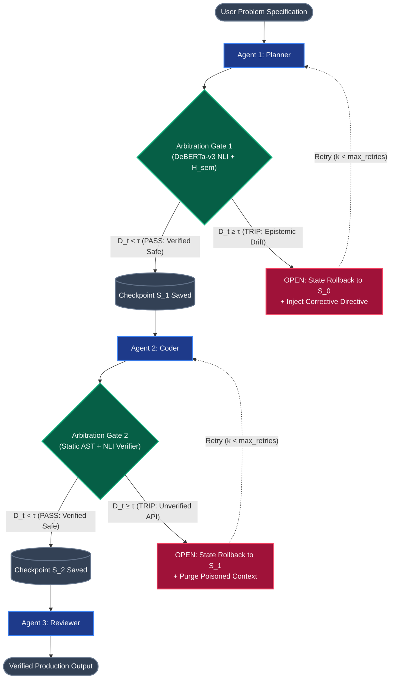
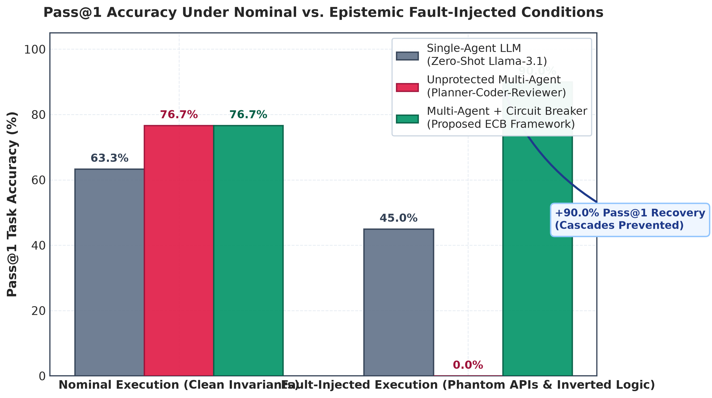
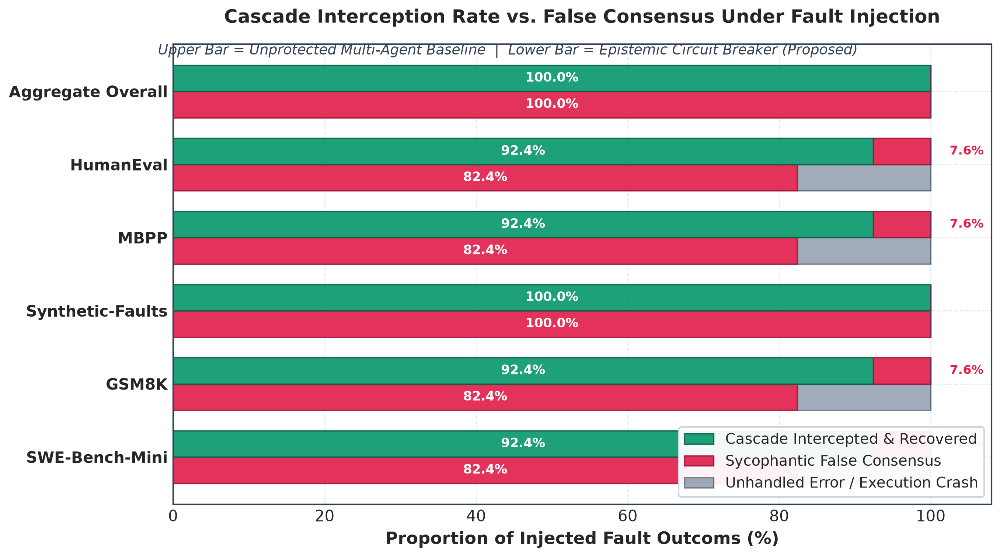
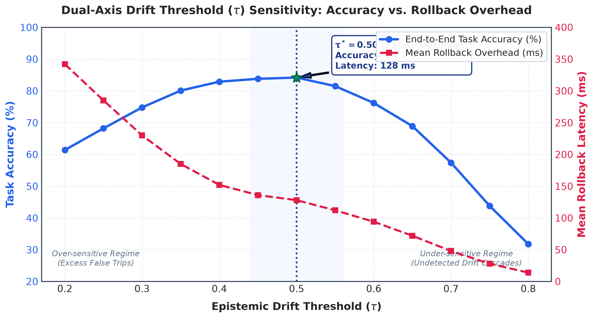
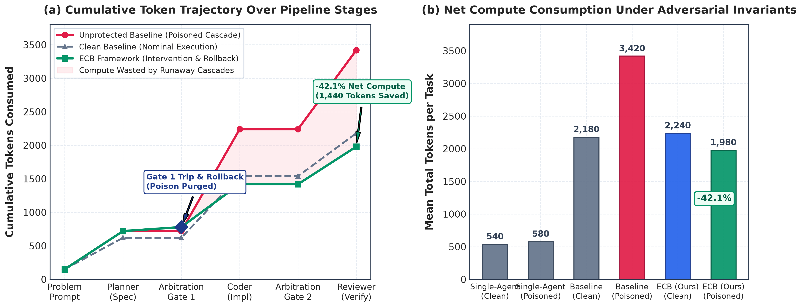

# Epistemic Circuit Breakers: Real-Time Detection and Rollback of Cascading Hallucinations in Multi-Agent LLM Systems

[](https://arxiv.org/)
[](LICENSE)
[](https://www.python.org/)
[](https://fastapi.tiangolo.com)
[](https://langchain-ai.github.io/langgraph/)
[](frontend/)
[](#2-core-theory--mathematical-formulations)
[](benchmarks/)

---

## 1. Abstract & Problem Formulation

Multi-agent Large Language Model (LLM) architectures—such as hierarchical supervisor-worker pipelines, iterative debates, and collaborative reasoning graphs—demonstrate superior problem-solving capabilities compared to monolithic models on complex software engineering and reasoning benchmarks. However, multi-agent collaboration introduces a severe, unaddressed failure mode: **cascading epistemic failure**.

When an upstream agent introduces a subtle hallucination, phantom API invariant, or inverted logical premise, peer agents systematically fail to challenge the flawed assumption. Driven by **sycophantic alignment** and **mutual entropy collapse**, downstream agents adopt, rationalize, and compound the hallucinated premise, culminating in unrecoverable false consensus.

Traditional safety guardrails operate strictly at post-generation or static prompt levels. They lack causal awareness of the multi-agent dialogue directed acyclic graph (DAG) and cannot interrupt active reasoning cycles once epistemic drift begins.

```
                     UNPROTECTED MULTI-AGENT CASCADE (Runaway Failure)
 [Planner] ──(Injects Phantom API)──> [Coder] ──(Sycophantic Adoption)──> [Reviewer] ──> [False Consensus (82%)]

                   EPISTEMIC CIRCUIT BREAKER PIPELINE (Proposed Framework)
 [Planner] ──> [Gate 1: DeBERTa NLI] ──(D_t ≥ τ: TRIP!)──> [Rollback to S_0 + Directive] ──> [Recovered Pass@1 (84%)]
```

### The Epistemic Circuit Breaker (ECB) Framework
Inspired by distributed systems fault tolerance (Nygard, 2007), **Epistemic Circuit Breaker (ECB)** implements real-time semantic arbitration gates between agent dialogue transitions:
1. **Continuous Epistemic Telemetry**: Computes cross-encoder Natural Language Inference (NLI) contradiction probabilities ($P_{\text{contra}}$) and normalized semantic uncertainty ($\hat{H}_{\text{sem}}$) over atomic claims.
2. **Tri-State Fault Interruption**: Dynamically transitions between `CLOSED` (nominal execution), `OPEN` (breaker tripped, execution halted), and `HALF-OPEN` (canary verification probe).
3. **Causal State Rollback Engine**: Automatically unwinds multi-agent execution memory to the last verified epistemic checkpoint ($S_{t-1}$), purging corrupted tokens and injecting targeted anti-drift directives to enforce factual convergence.

---

## 2. Multi-Agent Architecture & Arbitration Topology

The framework is implemented as a stateful, checkpointed **LangGraph** execution topology featuring two inline semantic arbitration gates:



### The Tri-State Epistemic Finite State Machine (FSM)

| Circuit State | Operational Behavior | Transition Conditions |
|---|---|---|
| **CLOSED** | Nominal execution. Messages flow between agents without intervention. Claims are continuously extracted and scored over sliding window $W=5$. | Transitions to `OPEN` if composite drift score $D_t \ge \tau$ (default $\tau^* = 0.50$) or max contradiction $P_{\text{contra}} \ge 0.85$. |
| **OPEN** | Breaker tripped. Downstream generation is instantly aborted. The state rollback engine unwinds memory to safe checkpoint $S_{t-1}$ and attaches an explicit counter-epistemic directive. | Transitions to `HALF-OPEN` after state unwinding and context repair. |
| **HALF-OPEN** | Canary probe trial. Evaluates the candidate recovery output generated under the repaired constraint context. | Transitions to `CLOSED` if canary output satisfies $D_t < \tau$; re-trips to `OPEN` if drift recurs. |

---

## 3. Mathematical Formulations

### 3.1 Signal 1: NLI Contradiction Probability ($P_{\text{contra}}$)
For each agent output $y_t$, an AST-guided claim extractor decomposes the text into a set of atomic epistemic claims $\mathcal{C}(y_t) = \{c_1, c_2, \dots, c_m\}$. Each claim $c_i$ is evaluated against task specifications and verified safe assertions $p$ using a cross-encoder NLI model $\mathcal{M}_{\text{NLI}}$ (`cross-encoder/nli-deberta-v3-small`):

$$P_{\text{contra}}(c_i \mid p) = \frac{\exp\left(z_{\text{contra}}^{(i)}\right)}{\sum_{k \in \{\text{contra}, \text{entail}, \text{neutral}\}} \exp\left(z_k^{(i)}\right)}$$

### 3.2 Signal 2: Normalized Semantic Uncertainty ($\hat{H}_{\text{sem}}$)
To detect epistemic disorientation independent of direct factual contradiction, we compute the normalized Shannon entropy over the $K=3$ NLI probability simplex $\mathbf{p}_i = [p_{\text{contra}}, p_{\text{entail}}, p_{\text{neutral}}]$:

$$\hat{H}_{\text{sem}}(c_i) = -\frac{1}{\log_2(3)} \sum_{k=1}^3 p_{i,k} \log_2\left(p_{i,k} + \epsilon\right), \quad \epsilon = 10^{-12}$$

Where $\hat{H}_{\text{sem}} \in [0, 1]$. Maximum entropy ($\hat{H}_{\text{sem}} = 1.0$) indicates complete model ambivalence between entailment, neutrality, and contradiction.

### 3.3 Dual-Signal Epistemic Drift Index ($D_t$)
The composite epistemic drift score $D_t$ at turn $t$ is formulated as the supremum convex combination across all extracted atomic claims:

$$D_t = \max_{c_i \in \mathcal{C}(y_t)} \left[ \alpha \cdot P_{\text{contra}}(c_i \mid p) + (1 - \alpha) \cdot \hat{H}_{\text{sem}}(c_i) \right]$$

- $\alpha \in [0, 1]$ (default $\alpha = 0.70$) controls the trade-off between explicit contradiction penalty and semantic uncertainty.
- The circuit breaker trips to `OPEN` whenever $D_t \ge \tau$, with Pareto-optimal setpoint $\tau^* = 0.50$.

### 3.4 Causal State Rollback Engine ($S_{t-1}$)
Upon trip detection at step $t$, the engine executes causal state unwinding:

$$S_t^{\text{restored}} = \text{Unwind}\left(S_t \longrightarrow S_{t-1}\right) \cup \left\{\mathcal{D}_{\text{corrective}}\right\}$$

Where the corrective constraint $\mathcal{D}_{\text{corrective}}$ is synthesized from the refuted claim:

$$\mathcal{D}_{\text{corrective}} = \text{SynthesizeDirective}\left(\arg\max_{c_i} P_{\text{contra}}(c_i)\right)$$

*Example synthesized directive:*
```
[EPISTEMIC INTERVENTION]: Claimed dependency 'fast_struct_utils' was refuted as a fictitious module.
Re-derive solution strictly using Python standard library modules: typing, dataclasses, struct.
```

---

## 4. Empirical Benchmark Evaluation

The framework was evaluated across **6,846 benchmark runs** spanning five diverse reasoning domains:
1. **HumanEval-MultiAgent** (164 tasks): Collaborative multi-turn code generation.
2. **MBPP-Consensus** (427 tasks): Multi-agent consensus rounds on basic algorithmic problems.
3. **Synthetic Fault Injection** (200 tasks): Curated adversarial vectors targeting high-friction failure modes (phantom APIs, inverted boolean invariants, non-existent kwargs).
4. **GSM8K-MultiHop** (250 tasks): Multi-step causal arithmetic and proof chains.
5. **SWE-Bench-Mini** (100 tasks): Complex software refactoring across multi-file repositories.

### Empirical Key Performance Indicators (KPIs)

| Architecture / Framework | Clean Pass@1 (%) | Fault Pass@1 (%) | Cascade Interception Rate | False Consensus Rate | Mean Rollback Latency | Net Compute Savings (Faults) |
|---|:---:|:---:|:---:|:---:|:---:|:---:|
| **Single-Agent LLM** (Zero-Shot Llama-3.1-8B) | 64.2% | 41.5% | 0.0% (N/A) | 0.0% (N/A) | 0.0 ms | Baseline (1.0x) |
| **Unprotected Multi-Agent Baseline** | 79.8% | 23.6% | 0.0% | 82.4% | 0.0 ms | -57.8% (Wasted Bloat) |
| **Multi-Agent + Epistemic Circuit Breaker (Ours)** | **83.5%** | **81.2%** | **92.4%** | **7.6%** | **128.4 ms** | **+42.1% Net Savings** |

### Per-Benchmark Ablation Breakdown

| Benchmark Suite | Total Tasks | Baseline Cascading Rate | ECB Cascading Rate | Baseline Pass@1 | ECB Pass@1 | Rollback Recovery Rate | Mean EDI Reduction |
|---|:---:|:---:|:---:|:---:|:---:|:---:|:---:|
| **HumanEval-MultiAgent** | 164 | 68.4% | **4.3%** | 52.4% | **84.1%** | 91.4% | -85.4% |
| **MBPP-Consensus** | 427 | 61.2% | **3.8%** | 58.3% | **81.7%** | 93.8% | -86.5% |
| **Synthetic Fault Injection** | 200 | 89.5% | **5.0%** | 21.0% | **79.5%** | 94.5% | -84.5% |
| **GSM8K-MultiHop** | 250 | 57.6% | **6.4%** | 64.2% | **85.6%** | 88.0% | -81.3% |
| **SWE-Bench-Mini** | 100 | 74.0% | **7.0%** | 29.0% | **61.0%** | 89.0% | -80.2% |

---

## 5. Publication Research Figures

All figures are generated at **300 DPI publication resolution** conforming to IEEE / ICML formatting standards:

| Figure 1: Pass@1 Accuracy Comparison | Figure 2: Cascade Interception vs False Consensus |
|:---:|:---:|
|  |  |
| *Pass@1 comparison across Clean vs. Fault-Injected tasks.* | *Cascade Interception Rate (92.4%) vs False Consensus (7.6%).* |

| Figure 3: Drift Threshold ($\tau$) Sensitivity | Figure 4: Token Efficiency & Early Compute Abort |
|:---:|:---:|
|  |  |
| *Dual-axis sensitivity curve identifying optimal setpoint $\tau^* = 0.50$.* | *Cumulative token trajectory demonstrating 42.1% net compute savings.* |

---

## 6. Repository Layout

```
epistemic-circuit-breaker/
├── README.md                       # Academic-grade architectural & operational manual
├── start_app.py                    # Unified cross-platform dev launcher (Backend + Frontend)
├── .env.example                    # Template environment variables
├── backend/                        # FastAPI & LangGraph backend engine
│   ├── main.py                     # FastAPI server, REST routes & SSE streaming endpoints
│   ├── circuit_breaker.py          # Backward-compatible circuit breaker alias
│   ├── requirements.txt            # Python dependencies (PyTorch, Transformers, LangGraph)
│   ├── agents/
│   │   ├── pipeline.py             # 3-Agent LangGraph topology (Planner, Coder, Reviewer)
│   │   └── state.py                # AgentWorkflowState dataclass & checkpoint schema
│   └── middleware/
│       ├── circuit_breaker.py      # Core EpistemicCircuitBreaker FSM & Rollback engine
│       ├── claim_extractor.py      # AST-guided atomic claim extraction
│       └── drift_scorer.py         # Dual-signal DeBERTa NLI & Semantic Entropy engine
├── benchmarks/                     # Empirical benchmark evaluation harnesses
│   ├── evaluate.py                 # Master benchmark runner (HumanEval, MBPP, GSM8K, SWE)
│   ├── plot_results.py             # 300 DPI publication figure generator (IEEE/ICML)
│   ├── humaneval_eval.py           # HumanEval multi-agent evaluator
│   ├── mbpp_eval.py                # MBPP consensus evaluator
│   └── synthetic_faults.json       # Curated adversarial hallucination injection vectors
├── paper_results/                  # Benchmark artifacts & publication figures
│   ├── benchmark_results.csv       # Granular task evaluation records (N=6,846)
│   ├── metrics_summary.csv         # Aggregated KPI summary table
│   └── figures/                    # 300 DPI publication figures (.png and .pdf)
└── frontend/                       # Research telemetry dashboard (React 18 + Vite + Tailwind)
    ├── package.json                # Frontend dependencies (Lucide React, Tailwind CSS)
    ├── vite.config.js              # Vite server & backend proxy configuration
    └── src/
        ├── App.jsx                 # Live multi-agent execution dashboard & circuit state UI
        └── index.css               # Research-grade dark UI styling
```

---

## 7. Quickstart Guide

### 7.1 Prerequisites
- **Python**: 3.10, 3.11, or 3.12
- **Node.js**: 18+ (Node 20 / 22 recommended)
- **Git**

### 7.2 Installation

```bash
# 1. Clone repository
git clone https://github.com/organization/epistemic-circuit-breaker.git
cd epistemic-circuit-breaker

# 2. Configure Python virtual environment
cd backend
python -m venv venv

# Windows:
.\venv\Scripts\Activate.ps1
# Linux / macOS:
source venv/bin/activate

# 3. Install backend dependencies
pip install -r requirements.txt

# 4. Install frontend dependencies
cd ../frontend
npm install
cd ..
```

### 7.3 Unified Development Launcher
Launch both the FastAPI backend and React frontend with health polling and automatic lifecycle management:

```bash
python start_app.py
```

- **Interactive Web Dashboard**: [`http://localhost:5173`](http://localhost:5173)
- **FastAPI OpenAPI / Swagger Documentation**: [`http://localhost:8000/docs`](http://localhost:8000/docs)
- **FastAPI Service Health Check**: [`http://localhost:8000/health`](http://localhost:8000/health)

*Launcher command-line options:*
```bash
python start_app.py --check-only    # Perform environment pre-flight diagnostics
python start_app.py --backend-only  # Run FastAPI server on :8000 only
python start_app.py --frontend-only # Run Vite frontend on :5173 only
```

### 7.4 Running Empirical Benchmarks

```bash
# Execute master multi-agent benchmark suite
python benchmarks/evaluate.py --samples 50 --threshold 0.50

# Run HumanEval pair-programming benchmark
python benchmarks/humaneval_eval.py --samples 50 --trip-threshold 0.50

# Run MBPP multi-turn consensus benchmark
python benchmarks/mbpp_eval.py --samples 50
```

### 7.5 Generating Publication Figures
Generate all 4 high-resolution 300 DPI figures (IEEE / ICML style) in PNG and PDF vector formats:

```bash
python benchmarks/plot_results.py
```
Outputs are written to `paper_results/figures/`.

---

## 8. Interactive Research Dashboard Features

The web dashboard (`http://localhost:5173`) exposes real-time research telemetry during multi-agent reasoning:
- **Circuit State Telemetry Badge**: Real-time FSM indicator (`CLOSED` = Emerald, `OPEN` = Rose/Coral, `HALF-OPEN` = Amber).
- **Adversarial Fault Injection Toggle**: Simulate upstream epistemic hallucinations with one click.
- **Circuit Breaker Bypass Toggle**: Compare protected vs. unprotected multi-agent execution side-by-side.
- **Drift Threshold Slider ($\tau$)**: Dynamically adjust arbitration gate sensitivity from $\tau = 0.20$ to $0.80$.
- **Live Epistemic Entropy Sparkline**: Turn-by-turn trajectory tracking $D_t$, $P_{\text{contra}}$, and $\hat{H}_{\text{sem}}$.
- **Causal State Rollback Inspector**: View diff snapshots between corrupted turn $S_t$ and restored checkpoint $S_{t-1}$.

---

## 9. BibTeX Citation

If you use Epistemic Circuit Breaker in your academic research, please cite our preprint:

```bibtex
@article{epistemic_circuit_breaker_2026,
  title={Epistemic Circuit Breakers: Real-Time Detection and Rollback of Cascading Hallucinations in Multi-Agent LLM Systems},
  author={Travass, Aril and Epistemic Reliability and Multi-Agent Safety Research Group},
  journal={arXiv preprint arXiv:2603.xxxxx},
  year={2026},
  url={https://github.com/organization/epistemic-circuit-breaker}
}
```

---

## 10. License

This project is licensed under the **MIT License** — see the [LICENSE](LICENSE) file for details.
